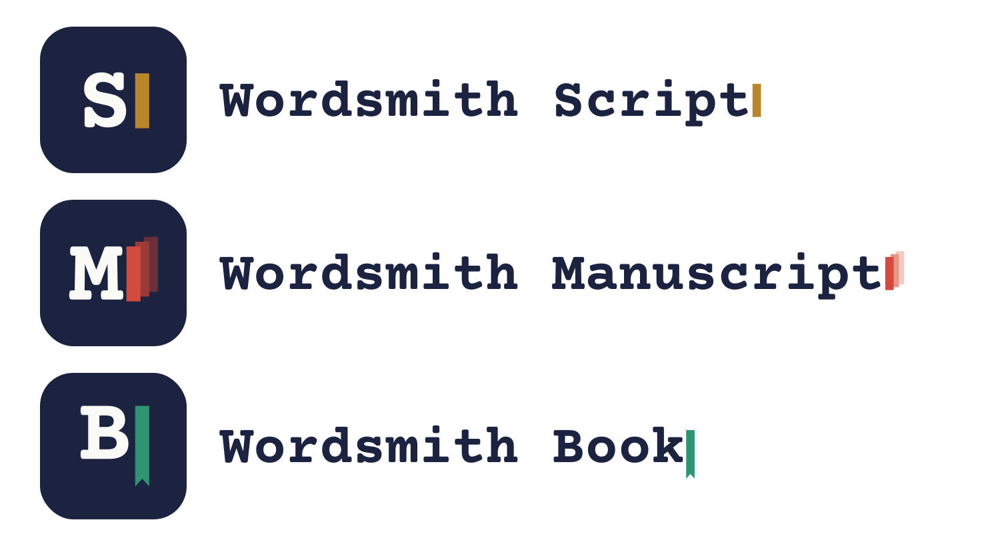

# Wordsmith brand guide

The identity of the Wordsmith suite, The James C. J. Foundation's free, open-source writing apps: **Wordsmith Script** (screenplays), **Wordsmith Manuscript** (novels and long work) and **Wordsmith Book** (book and ebook formatting). One guide for all three: the shared system first, then what each app owns. Version 3, 23 November 2026. The app names are working names until the trademark check is done.



## The idea

A writer's whole day is spent next to a blinking cursor, and a screenplay is still typed in a Courier face. So every Wordsmith logo is the app's name typed out in Courier Prime Bold, with a cursor waiting at the end of the line. Each app gives that cursor its own color and shape, taken from the object it works with:

| | Script | Manuscript | Book |
| --- | --- | --- | --- |
| What it's for | Screenplays | Novels and long work | Print books and ebooks |
| Icon letter | S | M | B |
| Cursor | **Brass bar**, from the brass brads that bind a script | **Card Red page stack**, from the red rule on index cards and a manuscript growing draft by draft | **Ribbon Green ribbon**, a bookmark: the writing is finished, keep your place |
| Cursor color | #B8862B | #D24B3E | #2E9473 |
| Files | `wordsmith-script/` | `wordsmith-manuscript/` | `wordsmith-book/` |

Everything here is original. Nothing is drawn from, or meant to resemble, any other writing or formatting product, its logo, icon, fonts or colors (see the clean-room rules in each app's spec). Courier Prime and Inter are open-licensed (SIL OFL 1.1), which allows using their letters in a logo.

## The shared system

These never change between apps:

- **The name** typed in Courier Prime Bold, normal spacing, title case: "Wordsmith Script", "Wordsmith Manuscript", "Wordsmith Book".
- **The cursor** always comes right after the last letter, 0.03 em away, and is as tall as the capitals. Never before the text, never on other words or headlines.
- **The icon**: a paper letter and the app's cursor, centered as one group on a `brand-ink` tile with a 22.5% corner radius.
- **Ink and paper**: Iron Gall Ink #1C2340 and Page White #FAFAF7.
- **Interface**: Inter for the UI, Margin Blue #3B4FA8 for links, focus and buttons, Slate #5A6080 for secondary text, Night #12162B for the dark theme.

Together the icons read as a set in a dock or taskbar and are still told apart at a glance by letter, cursor color and cursor shape.

## Logos

Every app has the same set, as outlined SVG paths (no font needed), in `<app>/logo/`:

| File | Use it for |
| --- | --- |
| `wordsmith-<app>-wordmark-ink.svg` | Primary logo on light grounds |
| `wordsmith-<app>-wordmark-paper.svg` | The same on dark grounds |
| `wordsmith-<app>-stacked-ink.svg`, `-paper.svg` | Narrow or square spaces: splash screen, posters, social cards |
| mark, `-ink.svg` / `-paper.svg` | The letter plus cursor alone: avatars, favicons, watermarks. Script's is `wordsmith-mark-*`, the others `wordsmith-<app>-mark-*` |
| `wordsmith-<app>-wordmark-mono-ink.svg`, `-mono-paper.svg` | One-color printing, embossing, laser output |

**Clear space.** The height of the capitals on every side. **Minimum size.** Wordmark 140 px wide on screen or 35 mm in print (160 px / 40 mm for Manuscript); below that, use the mark. Mark 16 px; under 48 px use the small app icon.

**Don't**
- Don't retype a name in another font or weight, change its case, or add letter-spacing.
- Don't swap cursors between apps, or pair one app's name with another's cursor.
- Don't move the cursor, put it before the text, or add a cursor to other words or headlines.
- Don't stretch, rotate, outline, add shadows, bevels or gradients.
- Don't put an ink logo on a mid-tone or busy photo; use the paper version on a dark area.
- Don't write the names as "WordSmith", in capitals or as abbreviations. In text: Wordsmith Script, Wordsmith Manuscript, Wordsmith Book; on second mention Script, Manuscript, Book.

## App icons

Every app has the same set in `<app>/icon/`:

| File | Platform |
| --- | --- |
| `wordsmith-<app>-icon.svg`, `icon-1024.png` … `icon-64.png` | Master artwork, full-bleed tile. Linux (hicolor), Windows Store tiles, website |
| `wordsmith-<app>-icon-macos.svg`, `icon-macos-1024.png` | macOS: artwork on the 824 px grid inside a 1024 canvas. Build the `.icns` from this |
| `wordsmith-<app>-icon-small.svg`, `icon-48.png`, `icon-32.png`, `icon-16.png` | Small sizes, taskbar, tabs (the letter is set a little larger) |
| `wordsmith-<app>.ico` | Windows executable icon (16 to 256 px inside) |
| `favicon.svg` | Website favicon |

## Color

### Shared

| Token | Light | Dark | Role |
| --- | --- | --- | --- |
| `brand-ink` "Iron Gall Ink" | #1C2340 | #1C2340 | Logos, icon tiles, title screens (fixed in both themes) |
| `brand-paper` "Page White" | #FAFAF7 | #FAFAF7 | Pages, reversed logos (fixed) |
| `surface-page` | #FAFAF7 | #12162B | App background |
| `surface-raised` | #FFFFFF | #1C2340 | Panels, cards, dialogs |
| `ink` | #1C2340 | #E9EAF2 | Body text. 14.7:1 and 14.9:1 |
| `ink-muted` "Slate" | #5A6080 | #9EA3BD | Secondary text. 5.9:1 and 7.2:1 |
| `accent` "Margin Blue" | #3B4FA8 | #9AABF2 | Links, focus, selection, primary buttons. 7.0:1 and 8.1:1 |
| `danger` | #B3261E | #F28B82 | Errors |
| `success` | #2E7D4F | #7CC79A | Saved and synced states |

### Each app's own color

| App | Graphic color (cursor, small fills; not for small text) | Text-safe version (light / dark) |
| --- | --- | --- |
| Script | `brand-brass` Brad Brass #B8862B (3.1:1 on paper, 4.8:1 on ink) | `brass-text` #8A6418 / #D9AE55 |
| Manuscript | `brand-red` Card Red #D24B3E (4.2:1 on paper, 3.5:1 on ink) | `red-text` #A8322A / #F08A7E |
| Book | `brand-green` Ribbon Green #2E9473 (3.6:1 on paper, 4.1:1 on ink) | `green-text` #1F7358 / #6CCBA6 |

The app color is a spice: one thing per screen, usually the text cursor itself. Writing space stays ink on paper.

**Revision colors.** Script and Manuscript share the `rev-*` tokens in the industry's revision order (White, Blue, Pink, Yellow, Green, Goldenrod, Buff, Salmon, Cherry, Tan). Light values tint revised pages; dark values are for margin marks and chips. Manuscript also uses them for labels, and Script for story-board beats, so there is one set of colors to learn.

Each app's `tokens.json` holds its full set with dark values and contrast notes. Palette files for design apps are in `<app>/palette/`: `.ase` (Adobe, Affinity, Procreate), `.gpl` (GIMP, Inkscape, Krita), `.css`, `.json`, and a PNG/SVG swatch card.

## Typography

| Role | Typeface | License | Where |
| --- | --- | --- | --- |
| Display | Courier Prime Bold | OFL 1.1 | Logos, title screens, headings of a few words, in sentence case |
| Interface | Inter (400, 500, 600) | OFL 1.1 | Menus, panels, buttons, docs, website body copy |

Never set long paragraphs in Courier outside a script or manuscript page.

## Wordsmith Script


**Cursor.** A solid brass bar, as tall as the capitals and 0.15 em wide, on the baseline. It may blink in motion pieces (splash screen, video intros): on 530 ms, off 530 ms, no fades. Everywhere else it is solid.

**In the product.**
- The script page is Courier Prime 12 pt, 10 characters and 6 lines to the inch (`script-page`).
- The in-app text cursor is brass.
- Revision colors tint revised pages and margins; story-board beats reuse them.

The scripts that drew the directions considered before C was chosen (twin nib, bound page) are kept in [`source/explorations/`](../source/explorations/). They are a record, not part of the build.

## Wordsmith Manuscript


**Cursor.** A stack of three sheets. The front sheet is the usual bar (as tall as the capitals, 0.15 em wide); two more sheets step back behind it, each 0.095 em to the right and 0.05 em higher. On light grounds the back sheets fade toward the ground (#E8968A, #F4CBC3); on dark grounds, including the icon, they deepen (#9C3A3A, #6B2F3C). In one-color versions they become slivers separated by a small gap. It never blinks.

**In the product.**
- The in-app text cursor stays a normal thin bar in Card Red; the page stack is for the logo, the icon and brand moments (splash screen, the drafts view).
- The writing page defaults to standard manuscript format: Courier Prime 12 pt, double-spaced, 1-inch margins (`manuscript-page`). Writers can switch the editor to any font; exports follow the manuscript format.
- The corkboard uses `cork` (#E8DCC4 / #2A2540) behind `card` (#FFFFFF / #232A4C) index cards. Ink text on cork is 11.3:1.
- Card Red is for the cursor, a card's rule line, label dots and status stamps. Errors use `danger`, so Card Red never means "something is wrong" on its own.

## Wordsmith Book


**Cursor.** A ribbon bookmark: a bar 0.15 em wide that starts at the height of the capitals and drops 0.30 em below the baseline, ending in a V notch. It never blinks. It may drop into place once (300 ms) when an export finishes.

**In the product.**
- Brand fonts stay in the app's chrome. Book previews always use the fonts of the chosen book design (EB Garamond, Literata and the other bundled OFL faces), never Courier Prime or Inter. The brand never leaks into a writer's book.
- Print previews show the page on `stock-white` (#FFFFFF) or `stock-cream` (#F3EBD9), fixed in both themes. Trim, bleed and safe-area guides use `trim-line` (#D24B3E / #F08A7E).
- Green also marks a passed preflight check, always with `green-text` and a check icon, never color alone.
- For Wordsmith And Ink books, Courier Prime with the ribbon cursor can appear in the colophon and on part pages; the interior text follows the book design.

## Voice

Wordsmith talks like a writer helping another writer: plain, warm, short. It names things by what writers call them (scene heading, chapter, draft, trim size), never by internal names, and never names other writing or formatting products in the interface or marketing.

- Yes: "Your book is saved on this computer." No: "Document persisted to local storage."
- Yes: "Free and open source, for every writer." No: "The ultimate industry-killer."
- Plain-text credit for the code the apps build on ("based on WordCraft by the ArtCraft team") goes in About and the README only, never next to a logo.

## Growing the family

A new Wordsmith product types its own name the same way, takes its own first letter for the icon, and picks a cursor color (at least 3:1 on both ink and paper, and different from the others in lightness as well as hue) and, if it helps, a cursor shape that comes from the product's own world. Wordsmith And Ink, the possible publishing imprint, would follow the same rule. The Foundation's own identity stays separate; a Wordsmith logo can say "a project of The James C. J. Foundation" in text under it, never merged into it.

## Files and repositories

The kit is the `brand/` folder of the wordsmith repository, and the only source of these files:

```
brand/
  README.md                what is in the kit, and how to rebuild it
  LICENSE.md               how the names and logos may be used
  suite/                   this guide, and wordsmith-suite-overview.png (the three apps side by side)
  wordsmith-and-ink/       the parent brand: logo/ app-icon/ lockups/ palette/ tokens.json
  wordsmith-script/        logo/ app-icon/ palette/ production/ tokens.json
  wordsmith-manuscript/    the same layout
  wordsmith-book/          the same layout
  pdfs/                    the guidelines laid out as pages
  source/                  the scripts that build the logos, icons, palettes and PDFs
  apps.json                what each app's repository carries from the kit, written by a tool
```

**Who owns what.** The kit owns the seven palette colors of each app and every logo and icon. An app owns its interface theme: its own `tokens.json`, in the token format of open-source-core's `jcj-theme`. That file is not a copy of the kit's `tokens.json`, and the app decides every interface color in it; only the seven palette colors it names must be the kit's. The kit's `tokens.json` files are the brand's reference, with dark values and contrast notes; no app reads them.

**How the files reach an app.** Each app's repository keeps the kit's files for that app in `assets/brand/`, byte for byte: its `production/` set and the icons it uses from `app-icon/`. [`apps.json`](../apps.json) lists them, each with its checksum, beside the two kinds of file in that folder that are the app's: its own (the theme file, the folder's README) and those it derives from a kit file with its own tool (the mask it paints the mark from). One tool makes and checks the copies: `npm run brand -- --app <app>` in `website/wiki` writes the kit's files into the app's checkout and records the kit commit they came from, and `npm run brand:check -- --app <app>` compares. A copy is never edited, recolored or rescaled in an app, and an app makes no icon size of its own: the kit has every size.

The logos and icons are rebuilt by `python3 brand/source/build.py` when a name, a color or a shape changes ([`brand/README.md`](../README.md#rebuilding)). Route F of the [project map](../../project/README.md#route-f) has the steps for a change that must reach the copies, and [project decision 0007](../../project/decisions/0007-brand-files-reach-the-apps-by-one-route.md) the reasons.

**Licensing.** The apps' code is open source; the names and logos are the Foundation's trademarks, and the brand files are not open source. [`brand/LICENSE.md`](../LICENSE.md) says how they may be used: unchanged, to refer to the project, but not for forks or other products. Each app ships its copies with a README that says the same. Because the logos are set in an open font, their distinctiveness comes from the names plus the cursors, so use them consistently.

## Open items

1. Trademark check on the three app names.
2. Before release: build each `.icns` from `icon-macos-1024.png` and test the three icons together in light and dark docks and taskbars.
