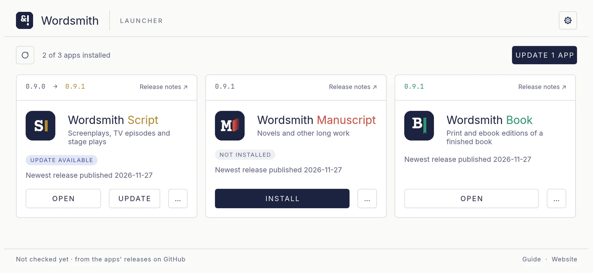

---
# Made by website/wiki/scripts/guide.mjs from launcher/docs/guide/apps.md in jamescjfoundation/wordsmith.
# Never edit this page: change the guide in the app's repository, then run `npm run guide`.
title: "The apps"
description: "The list, installing an app, updating it, opening it and removing it, and where apps go on your computer."
---

The launcher's window has a card for each app: Wordsmith Script, Wordsmith Manuscript and
Wordsmith Book, as many side by side as the window has room for. At the top of a card is the
version: the one installed, or the newest when the app is not installed, and "0.9.0 → 0.9.1"
when a newer one is waiting. Under the app's name is a line that says when the newest release
was published, and at the foot of the card are the buttons for what can be done now.

A card marked **Update available** has a newer release than the one installed, and one marked
**Not installed** is not on this computer. Point at the line under the name to see all the
launcher knows about the app:

| The line | What it means |
| --- | --- |
| Looking for it on this computer… | The launcher is looking for the app's program and asking it its version |
| Not installed. The newest is version X.Y.Z, published on a day. | The app is not here. **Install** fetches that version |
| Version X.Y.Z is installed. It is the newest. | Nothing to do |
| Version X.Y.Z is installed. Version X.Y.Z is available. | A newer release exists. **Update** replaces the installed one |
| The newest release could not be read. | GitHub did not answer; the reason is under the line. What is installed still opens |
| No release is published yet. | The app has no download yet |

A version before 1.0.0 is marked "a preview". **Release notes**, at the top of a card, opens the
release's page, with its notes; it is also under the **…** button.

The round arrow above the cards (or F5) asks GitHub again for the newest version of each app.
The line at the foot of the window says when it last did. When an app has an update, a button
at the other end of that row (**Update 1 app**, **Update 2 apps**) updates every app that has
one.

The button with the gear, at the top right, opens the launcher's preferences. Its keys and the
About page are beside them.

## Installing an app

Choose **Install**. The card shows each step:

1. Reading the release: the launcher reads the list of checksums of the release.
2. Downloading: about 55 MB for each app.
3. Checking the download: the file's checksum is compared with the release's list. A file that
   does not match is thrown away and nothing is installed
   ([How a download is checked](./checking-a-download.mdx)).
4. Unpacking and installing.

Then the card shows which version is installed, and **Open** starts the app.

Nothing asks for an administrator's password: an app is installed for your account only.

## Where an app goes

| System | Where | What you get |
| --- | --- | --- |
| Linux | `~/.local` | The program in `~/.local/bin`, the app in your desktop's menu, its icons and its file types. This is what the app's own `install.sh` does, and the launcher runs that script |
| Windows | `%LOCALAPPDATA%\Programs`, one folder for each app | The app's folder, with its file types registered for your account. It has no Start menu entry: open it from the launcher, or make a shortcut to the program in its folder |
| macOS | The `Applications` folder in your home folder | The app, as if you had dragged it there |

On Linux, an app you installed yourself from the same download is in the same place, so the
launcher finds it and can open and update it.

## Updating an app

Choose **Update** on the app's card, or the button above the cards that updates every app with
an update. The steps are the same as for installing, and the new version takes the old
one's place. Your documents and the app's settings are not touched.

Close the app first. The launcher does not replace an app that is running.

Each app also has an update check of its own, and can update itself. The launcher asks the
installed program for its version, so it shows the right one either way.

## Opening an app

Choose **Open**. The app starts as it does from your menu.

## Removing an app

Choose **…**, then **Remove…**, then **Remove** again on the card to confirm (**Keep** leaves
it). The app's program and
what was installed with it are taken away. Your documents and the app's settings stay where
they are.

The launcher removes only what it installed. An app you installed yourself has **Open** and,
when a newer version exists, **Update**, and no **Remove**: take it away the way you put it
there.
