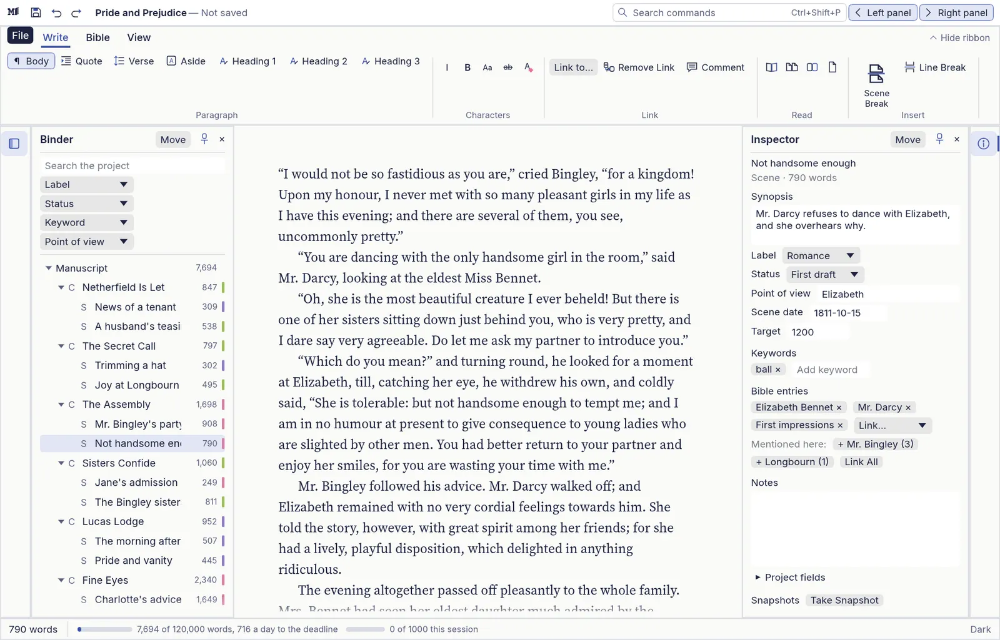

Wordsmith Manuscript is for writing a novel, a story collection or any other long piece of work.
You keep the book as a binder of parts, chapters and scenes, plan it on a corkboard and in an
outline, and keep its people and places in a story bible beside the text. When it is done, you
can give an editor a standard manuscript, or pass the book to Wordsmith Book to typeset.

It runs on macOS, Windows and Linux. It is free and open source (MIT or Apache-2.0), made by
The James C. J. Foundation.

## Where it stands

<Callout type="warn" title="Pre-release">
  Manuscript has no installers yet. Version 1.0 is prepared but has not been published, so for now
  you build it from source. [Getting started](./getting-started.mdx) shows how.
</Callout>

Everything described in this section works in the current code. Features that are still to come
are marked <Status value="planned" /> and listed in [What's next](./whats-next.mdx).

## What you can do today

- **Keep the whole book in one place.** Parts, chapters, scenes, front and back matter, plus a
  Story Bible, Research (with pictures, PDFs and web links) and Notes.
- **Write without fuss.** Only the styles a manuscript needs, curly quotes and dashes for your
  language, spelling that learns your characters' names, focus mode, and a split editor.
- **Read a chapter, or the whole book, as one text** and edit it there.
- **Plan.** Index cards on a corkboard, a sortable outline, a freeform board, lanes for plot
  threads and a timeline of your story's own dates.
- **Keep a story bible** of characters, places, objects, groups, lore and plot threads, linked
  to the scenes they appear in. A series can share one bible.
- **Track progress.** Word targets with a deadline, a writing calendar, snapshots, revision
  passes in color, and whole drafts kept side by side.
- **Bring your work in and take it out.** Import from Word, OpenDocument, RTF, Markdown, web
  pages, EPUB and plain text. Export a standard manuscript and other formats. Every import and
  export is checked word for word.
- **Keep your files.** A project is a folder of plain text files, with auto-save, crash recovery
  and backups.

The interface is in English and Spanish.

## In this section

<Cards>
  <Card title="Getting started" href="/manuscript/getting-started/">Build the app and start your first novel.</Card>
  <Card title="The binder" href="/manuscript/binder/">Parts, chapters, scenes, research and the Trash.</Card>
  <Card title="Writing" href="/manuscript/writing/">Styles, smart typing, split panes, focus mode, find and spelling.</Card>
  <Card title="Planning" href="/manuscript/planning/">Corkboard, outline, board, lanes, timeline and the inspector.</Card>
  <Card title="The story bible" href="/manuscript/story-bible/">Characters, places and more, linked to your text.</Card>
  <Card title="Drafts and progress" href="/manuscript/drafts-and-progress/">Targets, history, snapshots, revision passes and drafts.</Card>
  <Card title="Importing and exporting" href="/manuscript/import-and-export/">Bring documents in and send your manuscript out.</Card>
  <Card title="Sending to Wordsmith Book" href="/manuscript/sending-to-book/">Hand the finished book over to be typeset.</Card>
  <Card title="Files, saving and backups" href="/manuscript/files/">What a project is and how your work is kept safe.</Card>
  <Card title="Keyboard shortcuts" href="/manuscript/keyboard-shortcuts/">Every default key.</Card>
  <Card title="What's next" href="/manuscript/whats-next/">What is planned but not built yet.</Card>
</Cards>
