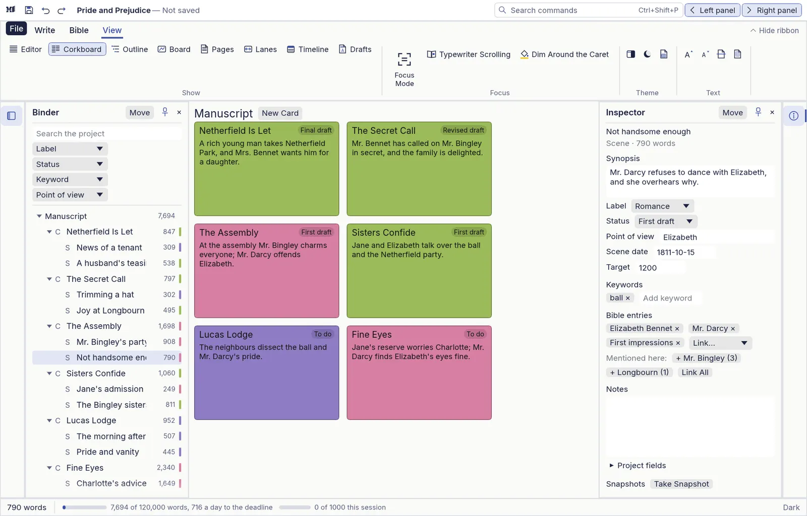
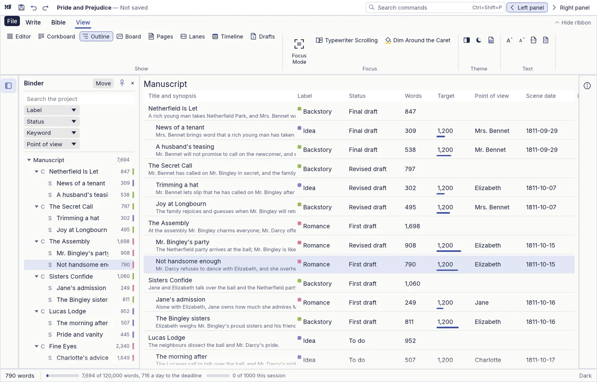

Manuscript gives you several ways to look at the shape of your story. They all show the same
binder, so a change in one shows in the others. Switch between them on the View tab, or with
<Kbd>Mod</Kbd>+<Kbd>1</Kbd> (the editor) to <Kbd>Mod</Kbd>+<Kbd>7</Kbd>.

| View | Key | Shows |
| --- | --- | --- |
| Editor | <Kbd>Mod</Kbd>+<Kbd>1</Kbd> | The text |
| Corkboard | <Kbd>Mod</Kbd>+<Kbd>2</Kbd> | Index cards for a folder's items |
| Outline | <Kbd>Mod</Kbd>+<Kbd>3</Kbd> | A table of everything under a folder |
| Board | <Kbd>Mod</Kbd>+<Kbd>4</Kbd> | A free canvas of cards and lines |
| Pages | <Kbd>Mod</Kbd>+<Kbd>5</Kbd> | Standard manuscript pages (see [Writing](./writing.mdx#pages)) |
| Lanes | <Kbd>Mod</Kbd>+<Kbd>6</Kbd> | Scenes in rows by plot thread or point of view |
| Timeline | <Kbd>Mod</Kbd>+<Kbd>7</Kbd> | Scenes on your story's calendar |

## The corkboard

The corkboard shows the selected folder's items as index cards, each with its title, synopsis,
label color and status.

- Drag a card to move the item.
- New Card adds an item at the end.
- Double-click a card to edit its title and synopsis.

## The outline

The outline shows everything under the selected folder as a table: title and synopsis, label,
status, words, target with progress, a column for each of your own fields, and keywords.

- Click a column heading to sort. Sorting only changes the view; **Apply This Order to the
  Binder** makes it real (and can be undone in one step).
- Double-click a cell to edit it.
- Drag rows to move items while the table is in binder order.

## The board

The board is a canvas for thinking, with cards anywhere and lines between them.

- Double-click the canvas (or choose Add Card) for a free note.
- **Add the Selected Item** puts a binder item on the board. Its card always shows the item's
  current title and synopsis.
- Drag cards to move them. Drag from a card's edge to another card to draw a line.
- Double-click a note to write on it, or an item's card to open the item.
- Delete takes the selected cards off the board. The items stay in the binder.
- Arrange lines up the selected cards (or all of them) in a grid.

Every change can be undone, and the board is saved with the project.

## Thread lanes

Lanes lay your scenes out in story order, one row per plot thread. A scene sits in a thread's
lane when it is linked to that thread's entry (a Plot Thread in the story bible, linked in the
inspector). Scenes that are in no thread share the last row. Gaps in a row show where a thread
goes quiet.

Switch to **Points of view** for one row per point-of-view character instead.

Drag a card to another lane to move the scene to that thread or point of view. Double-click a
card to open the scene.

## The timeline

The timeline puts your scenes on your story's own calendar, not the order of the book.

It uses the project's date field. If there is none, the timeline offers to add a "Scene date"
field. Give a scene its date in the inspector or the outline, written as YYYY-MM-DD (for example
1811-09-29).

Scenes are placed along a line from the earliest date to the latest, with scenes on the same day
stacked. Each card's number is its place in the book, so a flashback stands out. Scenes without a
date are listed below. Double-click a card to open the scene.

## The inspector

The inspector, on the right, holds the selected item's:

- synopsis (shown on its card and in the outline);
- label (one color) and status;
- custom fields;
- target;
- keywords;
- linked bible entries;
- notes;
- comments and snapshots.

Changes are kept as soon as you leave a field.

### Suggested bible links

Under the linked bible entries, **Mentioned here** lists entries whose name or alias the text uses
but which aren't linked yet, most mentioned first. Click one to link it, or Link All.

### Custom fields

Every project starts with a **Point of view** field. Add your own under Project fields at the
bottom of the inspector:

- text;
- a date (written YYYY-MM-DD, so dates sort in order);
- a checkbox;
- a list of choices.

Scene date, location, weather or "needs research" are all good uses. Each field is also a column
in the outline, where you can edit and sort it. Renaming a field keeps every value. Removing a
field that is in use asks first.

### Labels, statuses and keywords

Each project has its own lists of labels, statuses and keywords. Removing one that items use asks
first, and then clears it from those items.

## Filters

Above the binder, filter by label, status, keyword and point of view. The binder, the corkboard
and the outline all show only what matches. Show All clears the filter.
