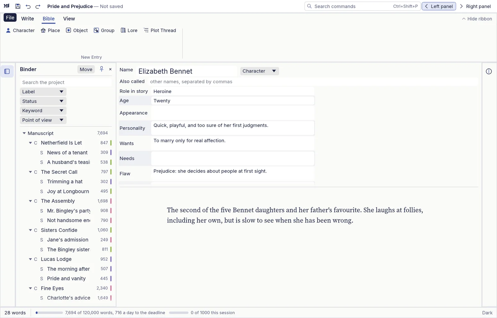

The Story Bible area of the binder holds **entries**: characters, places, objects, groups, lore
and plot threads. Each type has its own sheet of fields. A character, for example, has a role in
the story, age, appearance, personality, wants, needs, flaw and history. Every entry also has
aliases (other names it goes by) and a free text body.

## Making entries

- Use the **Bible** tab, or right-click the Story Bible area. A new entry goes in its type's
  folder.
- The entry view shows the name, type, aliases and fields at the top, and the body below in the
  editor.
- **Add a field** adds a field of your own to just this entry.

## Entries and your text

- **Links.** Select words in a scene and use Write › Link to… (<Kbd>Mod</Kbd>+<Kbd>K</Kbd>) to
  link them to an entry.
- **Linked entries.** In the inspector, link the entries that appear in a scene. Manuscript also
  suggests entries the scene mentions by name (see [Planning](./planning.mdx#suggested-bible-links)).
- **Backlinks.** Each entry lists the documents that link to it, and those that mention its name
  or an alias without a link.
- **Spelling** accepts every entry's name and aliases.

## Your own entry types

Right-click Story Bible › **Entry Types…** (or Entry Types in the command palette) to change what
each type of entry asks for, or to add a type of your own: ships, spells, songs, anything your
story keeps track of.

Name a field and choose what it holds: text, long text, a list, a picture, or a link to another
entry. Move it up or remove it, then Save Type.

- Renaming a field keeps every entry's value under the new name.
- Removing a field never removes what you wrote: the values stay with the entry, after the type's
  fields.
- A changed default type can go back to the default. A type of your own can be removed once no
  entry uses it.

## Relationships

An entry's Relationships section says how it stands to other entries: sibling of, married to,
friend of, rival of, parent of, works for, member of, lives in, owns, part of. Choose the relation
and the other entry, then **Relate**.

The other entry shows the relationship too, read its way: "child of" for "parent of", "employs"
for "works for". × removes a relationship from either side.

## A series

The books of a series can share one story bible, so what you learn about a character in book one
is there in book three.

<Steps>
<Step>

### Start the series

In the first book, run **Series** in the command palette. Give the series a name and a folder for
its bible, then choose **Start a Series**. This book's bible moves into that folder.

</Step>
<Step>

### Add the next book

Open the next book, run **Series**, give the same folder and choose **Join a Series**. Its own
entries join the series' entries, and it sees all of them.

</Step>
</Steps>

Every book in the series now reads and writes the same entries. What one book saves appears in
the others, and the status bar tells you. If two books change the same entry at the same time,
both versions are kept. The Series window lists the books, with Open buttons.

**Leave the Series** gives the book a copy of the bible as its own again.

## Importing a folder of notes

If you already keep notes on your world as Markdown files, File › Import › **Notes Folder into
the Story Bible** brings them in:

- each note becomes an entry named after its file;
- front matter (`aliases`, `type`, and any other field) becomes the entry's aliases, type and
  fields;
- `[[Name]]` and `[[Name|text]]` become links. A link to a name no entry has keeps its text and is
  listed in the import report;
- subfolders become bible folders.
