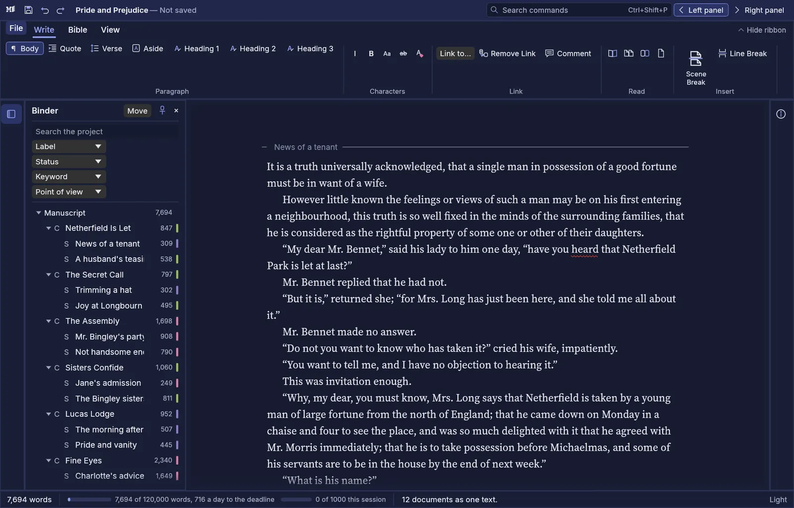
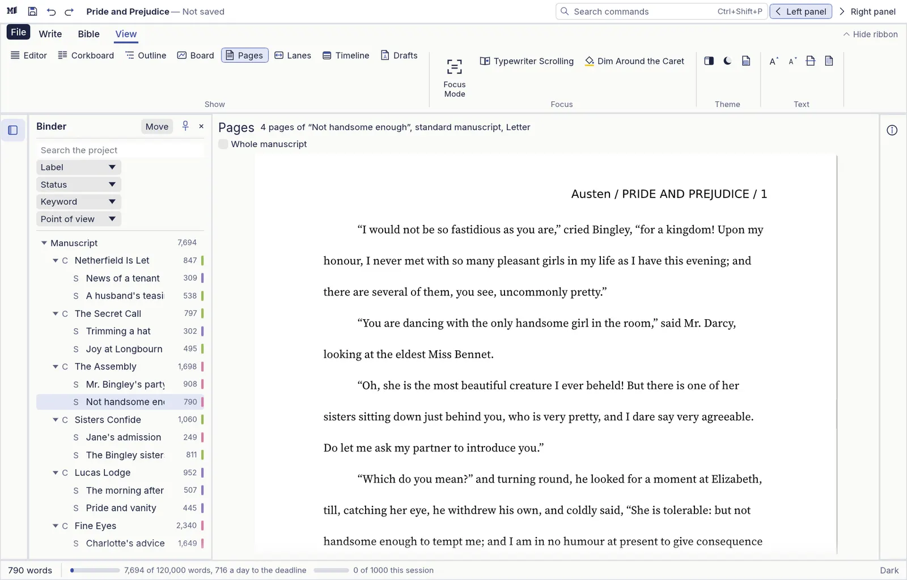

## Styles

The Write tab offers only the styles a manuscript needs.

| Paragraphs | Characters |
| --- | --- |
| Body, Block quote, Verse, Aside (a letter, note or message), Heading 1 to 3 (for front matter pages), Scene break | Italic, Bold, Small caps, Strikethrough, Language, Plain |

The first paragraph after a heading or a scene break is shown without its indent, as books set it.

**Scene breaks** (<Kbd>Mod</Kbd>+<Kbd>Shift</Kbd>+<Kbd>Enter</Kbd>) are paragraphs of their own.
Exports print them with the symbol you choose.

**Pasted text** comes in as plain text, one paragraph per line, so no stray fonts or colors get in.

## Smart typing

As you type:

- straight quotes become curly quotes for the project's language (English “ ”, German „ “,
  French « » and others);
- two hyphens become an em dash, and a hyphen with spaces around it an en dash;
- three periods become an ellipsis.

Press <Kbd>Backspace</Kbd> right after a change to get back what you typed.

## Reading several documents as one

**Read as One Text** (<Kbd>Mod</Kbd>+<Kbd>Alt</Kbd>+<Kbd>R</Kbd>) opens the selected chapter or
part, with everything under it, as one continuous text. **Read the Whole Manuscript**
(<Kbd>Mod</Kbd>+<Kbd>Alt</Kbd>+<Kbd>Shift</Kbd>+<Kbd>R</Kbd>) does the same for the whole book.

A line with each document's title separates them. Edit freely: when the project is saved, each
document gets its own words back. A paragraph you type at the end of a document belongs to that
document. Documents are never merged or lost, even if you select across a divider and type.

## Two panes

View › Split (<Kbd>Mod</Kbd>+<Kbd>Alt</Kbd>+<Kbd>\\</Kbd>) shows two editors side by side; Split
Top and Bottom stacks them. Each pane holds a document or a text read as one.

Click a pane or its tab, or press <Kbd>Mod</Kbd>+<Kbd>Alt</Kbd>+<Kbd>O</Kbd>, to make it the
active one: the binder opens documents there. A document can be edited in only one pane at a
time. If the other pane already has it open, it opens read-only and catches up when you come back.
One Pane, or a tab's close button, goes back to one.

## Pages

View › Pages (<Kbd>Mod</Kbd>+<Kbd>5</Kbd>) shows the selected chapter or scene as standard
manuscript pages, laid out exactly as the PDF export will be, with the page count above. Tick
Whole manuscript to see the whole book with its title page. The pages follow your writing: write
in the editor and come back to see them.

## Comments

Select some words and choose **Add Comment** (<Kbd>Mod</Kbd>+<Kbd>Alt</Kbd>+<Kbd>M</Kbd>). The
words get a soft highlight and the comment opens in the inspector for you to write. The inspector
lists the document's comments in order. Remove takes a comment away and leaves the words as they
were.

Exports leave comments out, unless you tick "Comments as review comments". Then they become real
comments in DOCX, ODT and RTF files, for an editor to answer.

## Find and replace

<Kbd>Mod</Kbd>+<Kbd>F</Kbd> opens the find bar. Search the document, the selection or the whole
project, with match case and whole word. Patterns (regular expressions) work too, with `$1`
groups in the replacement.

Replace All across the project first takes a snapshot of every document it changes, so you can
always go back.

**Search the Project** (<Kbd>Mod</Kbd>+<Kbd>Alt</Kbd>+<Kbd>F</Kbd>) looks through the text,
notes, synopses and bible entries, and lists the results in the binder area.

## Spelling and grammar

Misspelled words get a wavy line. Right-click one for suggestions, Add to Project Words, or
Ignore All. Every bible entry's name and aliases count as words, so your characters' names are
never marked.

**Grammar hints** are off until you turn them on (Grammar Hints, in the command palette). Then
words a grammar or style rule questions get a dotted blue line; right-click for what the rule says,
a replacement, or Ignore. The check runs on your computer and nothing is sent anywhere. Nothing
changes unless you pick a replacement.

## Links

Select some words and use Write › Link to… (<Kbd>Mod</Kbd>+<Kbd>K</Kbd>) to link them to a bible
entry or another document. Hover over a link to see where it goes, and <Kbd>Mod</Kbd>-click to go
there. <Kbd>Mod</Kbd>+<Kbd>Shift</Kbd>+<Kbd>K</Kbd> removes a link.

## Focus and comfort

- **Focus mode** (<Kbd>F11</Kbd>) shows the text alone, full screen. <Kbd>Esc</Kbd> leaves.
- **Typewriter Scrolling** keeps the line you type at the same height.
- **Dim Around the Caret** fades the paragraphs other than the one you are in.
- **Light and dark themes, and a sepia page.**
- **Text size and column width.** These change only what you see, never your exports.

All of these are on the View tab.
