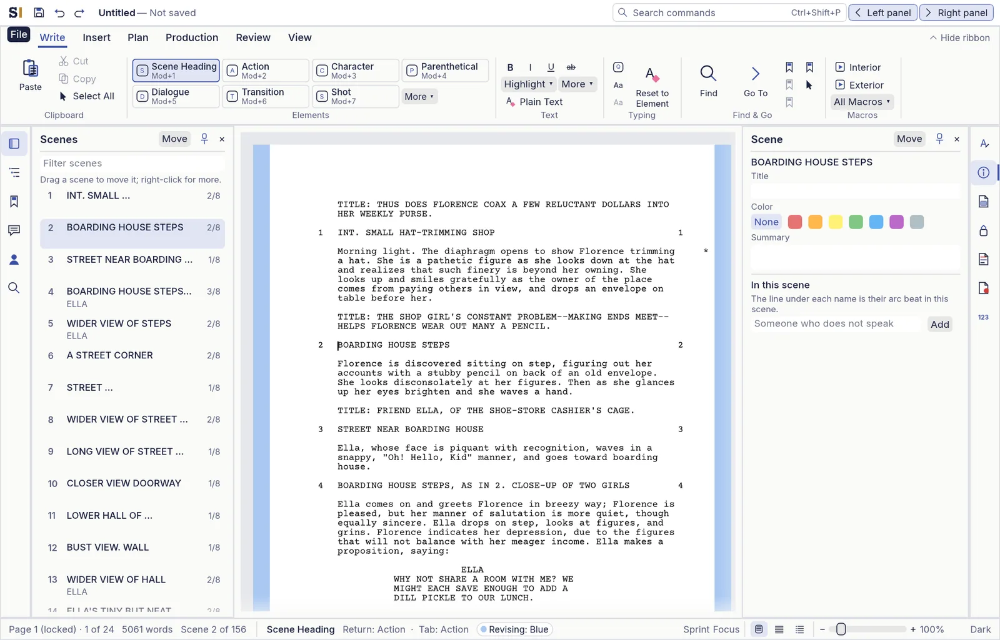

Wordsmith Script is a screenwriting app for macOS, Windows and Linux. You type,
and two keys (Return and Tab) do the formatting. You see every page as it will
print, and when the script goes into production you have revision colors,
locked pages and scene numbers.

<Callout type="warn" title="Not released yet">
Wordsmith Script is pre-release software. There are no installers yet: to try
it today you build it from its source code, which takes a terminal and a few
minutes. [Getting started](./getting-started.mdx) shows how. Installers for
macOS, Windows and Linux come with the first release.
</Callout>

## What you can do today

- **Write** with the screenplay elements (scene heading, action, character,
  parenthetical, dialogue, transition, shot and more). Return and Tab pick the
  next element, so you never set an indent by hand.
- **See real pages**: US Letter, Courier Prime 12 point, with (MORE) and
  (CONT'D) added for you, a title page, and headers and footers.
- **Plan** with index cards, a scene view, story boards of beats, an outline in
  lanes and a structure strip.
- **Go into production** with revision sets on the standard color cycle,
  locked scene numbers (12A), locked pages (12A) and revised-pages-only
  printing.
- **Check your script** with reports on scenes, locations, cast and
  characters, scene lengths in eighths of a page, and a format checker.
- **Keep your work safe** in plain-text files that compare cleanly, with
  auto-save, timestamped backups and crash recovery.
- **Move scripts in and out** with Fountain both ways, import from plain text,
  RTF and text PDFs, and export to PDF, RTF, plain text and HTML.

## Your privacy

The app has no telemetry. Your scripts, notes and file names never leave your
computer. The only thing it sends is an update check, which you can turn off.
See [Updates and privacy](./the-window.mdx#updates-and-privacy).

## In this section

<Cards>
  <Card title="Getting started" href="./getting-started.mdx">
    Build the app and write your first scene.
  </Card>
  <Card title="The window" href="./the-window.mdx">
    The ribbon, the side panels, the File page and the status bar.
  </Card>
  <Card title="Writing" href="./writing.mdx">
    Elements, Return and Tab, autocomplete, spelling, notes and macros.
  </Card>
  <Card title="Views" href="./views.mdx">
    Page, normal and draft views, index cards, scene view and tables.
  </Card>
  <Card title="Planning" href="./planning.mdx">
    Story boards, the outline, outline elements and the structure strip.
  </Card>
  <Card title="Pages and printing" href="./pages-and-printing.mdx">
    The title page, headers and footers, PDF and printing.
  </Card>
  <Card title="Production" href="./production.mdx">
    Revisions, scene numbers, locked pages, tracked changes and sides.
  </Card>
  <Card title="Characters and reports" href="./characters-and-reports.mdx">
    Scene properties, character details, reports and writing goals.
  </Card>
  <Card title="Files" href="./files.mdx">
    The .wss format, Fountain, import and export, backups.
  </Card>
  <Card title="Keyboard shortcuts" href="./keyboard-shortcuts.mdx">
    Every key, by area.
  </Card>
  <Card title="What's next" href="./whats-next.mdx">
    What is planned, and what is left out on purpose.
  </Card>
</Cards>
