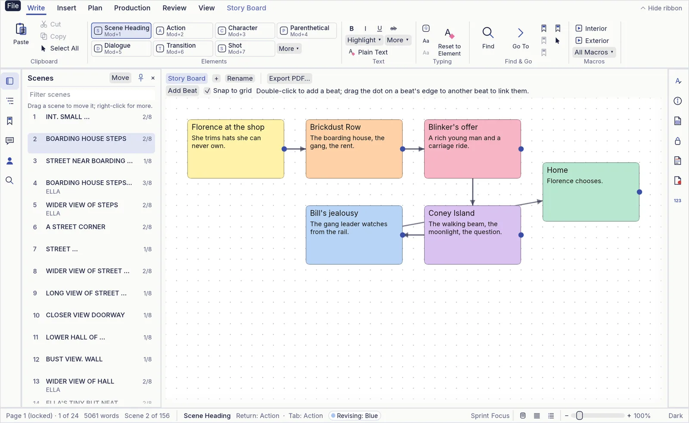

Wordsmith Script has two places to plan a story before (or while) you write it:
the **story board** and the **outline**. They show the same beats, so a change
in one is a change in the other. Beats are saved with the script.

## Story board

Open it from the **Plan** tab or with <Kbd>Mod</Kbd>+<Kbd>Alt</Kbd>+<Kbd>6</Kbd>.
A story board is a canvas of colored cards called **beats**.

- **Add a beat:** double-click the canvas where you want it, or use **Add Beat**
  on the **Story Board** tab.
- **Move beats** by dragging them. They snap to the grid unless you turn off
  **Snap to Grid**.
- **Link beats:** drag from the dot on a beat's right edge to another beat. Links
  stay attached as beats move. With a beat selected, **Links** lists its links:
  draw each as a plain line or an arrow (either way or both), pick its color, or
  remove it.
- **Edit a beat:** select it to color it, edit it or delete it. In the beat
  window, <Kbd>Tab</Kbd> moves between the title and the body, and "• List" or
  "1. List" starts a list line in the body.
- **Arrange:** Shift-click several beats, then put them on the grid, in a
  column, in a row or in a cascade.
- **Send to Script:** the beat's title goes into the script at the caret as an
  Outline 1 paragraph, and its body as a Summary.

A script can have **several boards**. The tabs above the board pick one, **+**
adds one, and **Rename** and **Delete Board** change the one showing. New beats
go on the board showing. **Export PDF** prints the board showing on one
landscape page.

## Outline

Open it from the **Plan** tab or with <Kbd>Mod</Kbd>+<Kbd>Alt</Kbd>+<Kbd>7</Kbd>.
The outline shows **lanes**, one per row: acts, sequences or anything you like.

- Add lanes yourself, or from a structure: three acts, five acts, three acts in
  eight sequences, or a television episode (teaser, four acts, tag).
- Rename lanes in place, move them and indent them.
- Drag beats between lanes and along them.
- Below the lanes are the beats in no lane, and the **Script** lane: your scenes
  with the page each starts on. A beat you have sent to the script shows the
  pages it covers.

## Outline elements in the script

Five elements are for you, not the reader: **Outline 1**, **Outline 2**,
**Outline 3**, **Summary** and **Note** (<Kbd>Mod</Kbd>+<Kbd>Shift</Kbd>+<Kbd>1</Kbd>
to <Kbd>Mod</Kbd>+<Kbd>Shift</Kbd>+<Kbd>5</Kbd>, or the **Structure** group on
the **Plan** tab). Use them to sketch acts and beats right in the script. They
have colored bars in the left margin, one color per level, and show up in the
Script panel's **Outline**.

**Show Outline** on the **Plan** tab switches them off in the page view, the PDF
and printing. They stay in the script and come back when you switch it on.

<Callout type="info">
Hidden outline elements still show in the normal and draft views.
</Callout>

## Scenes as cards and blocks

The [index cards and scene view](./views.mdx#views-for-structure) are planning
tools too: drag a card or a block and the scene moves in the script. The
[structure strip](./views.mdx#structure-strip) shows acts, sequences and scenes
along the pages.
