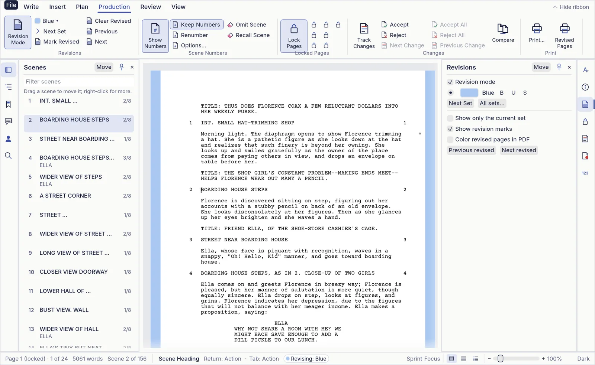

Once a script goes into production, its pages and scene numbers must stay put
while it keeps changing. Everything here is on the **Production** tab.

## Revisions

**Next Set** starts the next revision set in the industry color cycle and turns
**Revision Mode** on:

> Blue, Pink, Yellow, Green, Goldenrod, Buff, Salmon, Cherry, Tan, then Second
> White, Second Blue, and so on.

While revision mode is on, what you type is marked as revised, and so is a
paragraph where you delete text.

- Each revised line gets an asterisk (`*`) in the right margin.
- Revised pages have their margins tinted in the set's color on screen.
- The `{revision}` header field names the current set.
- A chip in the status bar shows that revision mode is on.

**Mark Revised** and **Clear Revised** act on the selection or the paragraph at
the caret. **Previous** and **Next** step through revised text.

### Revision sets

The **Revisions** panel in the Inspector (and **All sets…** there) lets you:

- rename sets and change their colors;
- give a set's text bold, underline or strike-through;
- change the mark, its position, and give each set its own mark;
- show only the current set;
- color whole pages in PDFs;
- hide the revision marks for printing;
- roll back to an earlier set (later marks are cleared; the text stays).

## Scene numbers

**Show Numbers** puts each scene's number in both margins. Until you lock them,
numbers follow the order of the scenes.

- **Keep Numbers** locks them. A scene keeps its number from then on, and new
  scenes take letters after the scene before them: 12A, 12B.
- **Omit Scene** leaves an OMITTED heading with the scene's number. **Recall
  Scene** brings the scene back.
- **Renumber** starts again from 1.

**Options…** lets you start at any number, start again every so many scenes,
letter added scenes as 1A or A2, show the numbers on the left, the right or
both, give them their own font, set one scene's number by hand, and renumber
everything, from the caret on, or only the scenes without a number.

## Locked pages

**Lock Pages** freezes the page breaks: each page keeps its number however the
script changes.

- Text that no longer fits goes onto added pages: 12A, 12B. After a second lock,
  pages added after 12A are 12AA, 12AB.
- A page whose text is all deleted leaves a placeholder. Two in a row become one
  page numbered like `10-11`.
- **Unlock a Level** undoes the newest lock. **Unlock All** numbers the script
  1, 2, 3 again.
- **Relock** numbers the pages 1, 2, 3 again from where they break now, and
  locks them.
- **Lock Page Here**, **Unlock Page**, and **Start Up** / **Start Down** (move a
  locked page's start up or down a paragraph) handle single pages.

The status bar shows a locked page's label, and **Go To**
(<Kbd>Mod</Kbd>+<Kbd>G</Kbd>) takes labels such as 12A.

## Printing revised pages

**Revised Pages** (in the **Print** group) prints only the pages with revised
text, with their locked numbers. **Export › Revised Pages as PDF** on the File
page saves them as a PDF. To print without the asterisks, turn off **Show
revision marks** in the Revisions panel. The full **Print…** window can also
print unrevised pages, one revision set, or
[sides](./pages-and-printing.mdx#print) for a character.

## Tracking changes

**Track Changes** (<Kbd>Mod</Kbd>+<Kbd>Shift</Kbd>+<Kbd>C</Kbd>) marks what you
type as inserted, and keeps what you delete, struck through, until it is
accepted or rejected. Each change remembers who made it and when (set your name
in **Preferences**). Step through changes with **Next Change** and **Previous
Change**, and **Accept** or **Reject** them one at a time or all at once. The
**Changes** panel in the Inspector lists them.

<Callout type="warn">
Spelling, find and exports don't see tracked changes yet: deleted text still
counts as there until you accept the deletion.
</Callout>

## Comparing two versions

**Compare** asks for the earlier version of a script. The comparison opens as a
new script: added text is marked as inserted, removed text as deleted, and moved
scenes get a note saying where they were.

## Scene lengths

The Scenes panel, the scenes table and the scenes report show each scene's
length in **eighths of a page**, as schedules expect. See
[Characters and reports](./characters-and-reports.mdx) for the reports.
