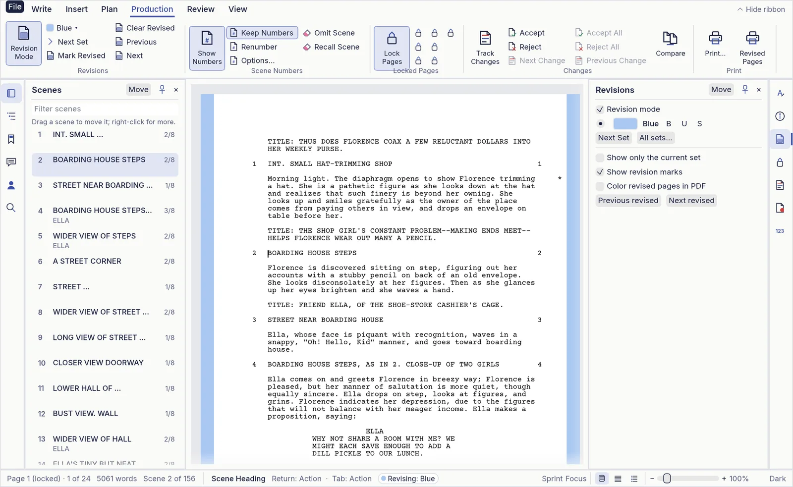

The window has four parts: the **ribbon** across the top, the **Script panel**
on the left, the **Inspector** on the right and the **status bar** at the
bottom. The script sits in the middle.

## The ribbon

The ribbon's tabs are named for screenplay work:

| Tab | What's on it |
| --- | --- |
| **File** | Opens the [File page](#the-file-page). |
| **Write** | Cut, copy and paste; the elements; text styles; typing options; find and go to; macros. |
| **Insert** | New scene, page break, dual dialogue; notes and bookmarks; the title page, header and footer, watermark. |
| **Plan** | Index cards, scene view, story board, outline, structure strip; outline elements. |
| **Production** | Revisions, scene numbers, locked pages, tracked changes, compare, printing. |
| **Review** | Check format, spelling, reformat; notes; reports and characters; writing statistics and sprints. |
| **View** | Page, normal and draft views; panels; split views; zoom; focus and typewriter modes; themes; tabs. |

**Story Board** and **Index Cards** tabs appear when you are in those views.

- Point at any control to see its name, its key and what it does.
- Double-click a tab, or choose **Hide ribbon**, to show only the tab names.
- When the window is narrow, groups drop their labels and then fold into a
  single button.
- **Every control is a command.** The search box in the quick-access row
  (<Kbd>Mod</Kbd>+<Kbd>Shift</Kbd>+<Kbd>P</Kbd>) finds any of them by name, and
  any of them can be given a key of your own (see
  [Keyboard shortcuts](./keyboard-shortcuts.mdx)).

### Using the ribbon from the keyboard

Press <Kbd>F10</Kbd> (or <Kbd>Alt</Kbd>+<Kbd>Space</Kbd>) and a letter appears
on every tab. Press a tab's letter, then the letters shown on a control to use
it. <Kbd>Escape</Kbd> leaves.

A control keeps its letters while the app runs, even when the window is
narrowed and its group folds. Drop-downs such as **More** or **All Macros**
have letters too: they open it, and the items inside then show letters of their
own.

### The quick-access row

Above the ribbon: save, undo and redo; the script's name and whether it is
saved; the command search box; and switches to show or hide the side panels. If
you prefer classic menus, **View › Menu Bar** adds them under this row.

## The side panels

### The Script panel (left)

- **Scenes:** click a scene to go there, drag it to move it, right-click for
  more. Each scene shows its length in eighths of a page.
- **Outline:** acts, sequences and outline paragraphs as a tree.
- **Bookmarks.**
- **Notes:** read and edit every note in place.
- **Characters:** highlights, traits and renaming.
- **Find:** results in context, with replace. It shares its search with the
  find bar.

### The Inspector (right)

- **Element:** the element at the caret, what Return and Tab make from it, and
  its formatting.
- **Scene:** title, color, summary, who is in it, arc beats.
- **Revisions:** revision mode and the current set.
- **Page:** lock tools, page number, scene numbers.
- **Changes:** accept or reject each tracked change.
- **Check Format.**
- **Goals.**

Click an icon on a rail to open its panel, and again to close it. Drag a panel's
edge to make it wider or narrower. The app remembers which panels were open and
how wide they were.

## The status bar

- **On the left:** the page (with its label when pages are locked), the word
  count and the scene. Click them to go somewhere, see statistics or show the
  scenes.
- **In the middle:** the element at the caret and what Return and Tab will
  make, plus chips that show when revision mode, change tracking or dual
  dialogue are on. Click a chip to open its panel.
- **On the right:** a sprint timer, focus mode, the theme, the view switches
  and the zoom.

## The File page

**File** opens a page in place of the script, with:

- **New:** templates, recent scripts and a few first steps
- **Open**, including import and recovering unsaved scripts
- **Save**, Save As, Save as Template and Revert
- **Export:** PDF, revised pages, Fountain, RTF, plain text, HTML, story board
  and index cards (see [Files](./files.mdx))
- **Print:** every choice, with a preview (see
  [Pages and printing](./pages-and-printing.mdx))
- **Compare** with another version
- **Preferences** (<Kbd>Mod</Kbd>+<Kbd>,</Kbd>)
- **Keys**
- **About**

<Kbd>Escape</Kbd> or **Back** returns to the script.

## Themes and looks

The app has a light theme, a dark theme and an extra-dark theme (**View** tab,
or the switch in the status bar). Zoom runs from 75 % to 300 %. The view, theme,
zoom, panels and window layout are remembered between sessions.

## Updates and privacy

When it starts, the app asks GitHub whether a newer version has been released.
**About** on the File page has **Check for Updates**, and so does
**Help › Check for Updates** in the menu bar. When an update is available you
see a Software Update window. On Linux the app can install the update and
restart; on macOS and Windows it opens the release's download page.

What the check sends, and how to stop it:

- It asks GitHub (`api.github.com`) for the list of Wordsmith Script releases.
  GitHub sees your IP address and the app's name and version. Nothing about you
  or your scripts is sent. If the check fails, it fails quietly and no other
  server is asked.
- An update is downloaded only when you choose to install it.
- To turn the check off, clear **Check for updates when the app starts** in
  **File › Preferences** (the same box is on the About page). The app then
  sends nothing unless you check by hand.

<Callout type="info" title="No telemetry">
The app never reports how you use it or when it crashes. Your scripts, notes
and file names never leave your computer.
</Callout>
