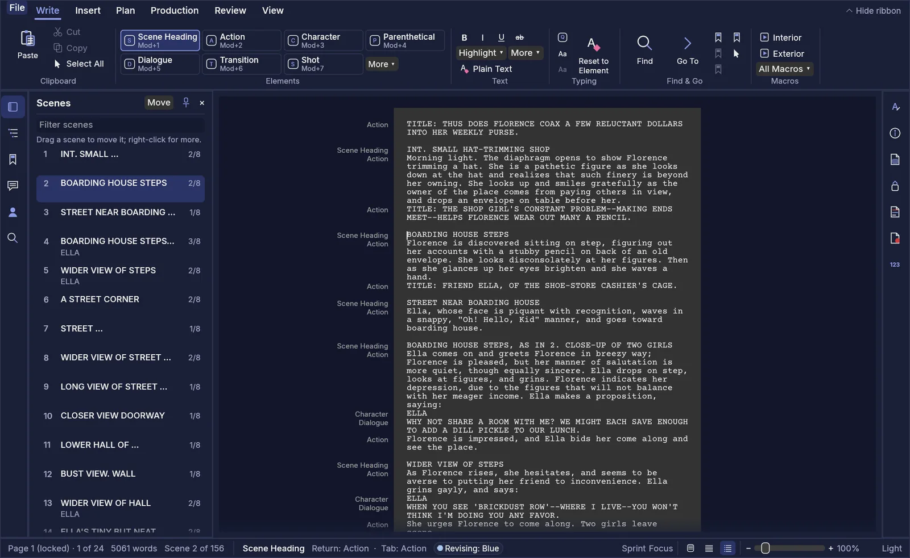
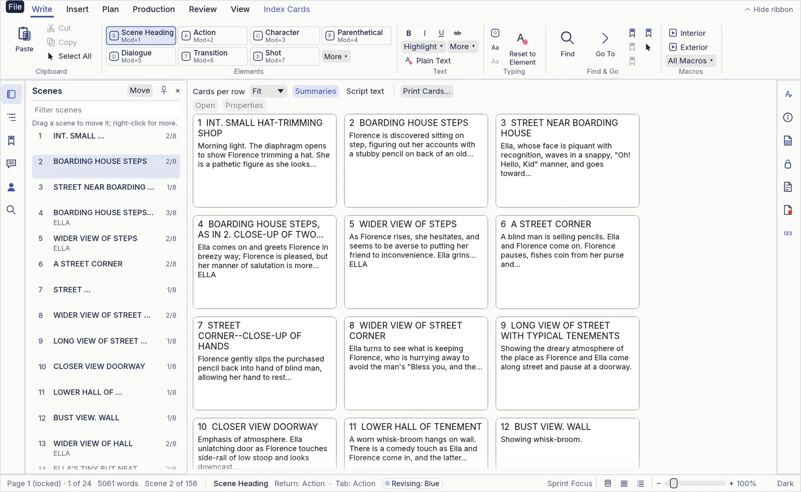

The same script can be looked at in several ways. Switch views on the **View**
and **Plan** tabs, with the switches in the status bar, or with the keys below
(**Mod** is <Kbd>Cmd</Kbd> on macOS and <Kbd>Ctrl</Kbd> elsewhere; **Alt** is
<Kbd>Option</Kbd> on a Mac).

## Views for writing

| View | Key | What it shows |
| --- | --- | --- |
| **Normal** | <Kbd>Mod</Kbd>+<Kbd>Alt</Kbd>+<Kbd>1</Kbd> | The script in one continuous column. |
| **Page** | <Kbd>Mod</Kbd>+<Kbd>Alt</Kbd>+<Kbd>2</Kbd> | The pages exactly as they print, with page numbers, (MORE) and (CONT'D), scene numbers and revision marks. |
| **Draft** | <Kbd>Mod</Kbd>+<Kbd>Alt</Kbd>+<Kbd>3</Kbd> | Every element at the left margin with its name beside it, for fast typing. |

## Views for structure

| View | Key | What it shows |
| --- | --- | --- |
| **Index cards** | <Kbd>Mod</Kbd>+<Kbd>Alt</Kbd>+<Kbd>4</Kbd> | A card per scene. |
| **Scene view** | <Kbd>Mod</Kbd>+<Kbd>Alt</Kbd>+<Kbd>5</Kbd> | Each scene as a block of its text. Drag a block to reorder. |
| **Story board** | <Kbd>Mod</Kbd>+<Kbd>Alt</Kbd>+<Kbd>6</Kbd> | Beats on a canvas. See [Planning](./planning.mdx). |
| **Outline** | <Kbd>Mod</Kbd>+<Kbd>Alt</Kbd>+<Kbd>7</Kbd> | Beats in lanes. See [Planning](./planning.mdx). |

In these views, typing doesn't go into the script. Keyboard shortcuts still
work, and <Kbd>Escape</Kbd> takes you back to the script.

### Index cards

Each card shows a scene's heading, its title and color, its summary (or the
start of its action) and who speaks. **Drag a card onto another to move the
scene there**: the script changes to match. **Open** goes to the scene, and
**Properties** opens its [scene properties](./characters-and-reports.mdx#scene-properties).

On the **Index Cards** tab you can choose how many cards go in a row (or let
them fit the window), and whether cards show the summary or the scene's text.
**Print Cards** saves the cards as a PDF: one per 3 × 5 inch card, or a grid on
Letter pages with your choice of columns, rows, frames and a grey background.

## Tables

**Tables** (<Kbd>Mod</Kbd>+<Kbd>Alt</Kbd>+<Kbd>T</Kbd>) opens a panel beside the
script with three tables:

- **Scenes:** number, heading, page, length in eighths of a page, who speaks,
  summary. Click a heading or summary to edit it, or drag a row to move the
  scene.
- **Characters:** speeches and scenes for each character. Edit a name to rename
  the character everywhere (see
  [Characters and reports](./characters-and-reports.mdx#renaming-a-character)).
- **Notes:** every note and where it is attached.

Click a column's name to sort by it (again to reverse, a third time to go back
to script order). Type in **Filter** to keep only matching rows. **Columns**
hides or shows columns. The **+** button keeps the table as it is now as a tab of
your own, which is saved with the script. The scenes and characters tables can
be saved as CSV for a spreadsheet.

## Structure strip

**Structure Strip** (<Kbd>Mod</Kbd>+<Kbd>Alt</Kbd>+<Kbd>S</Kbd>) shows a band
above the script: a lane for acts, sequences and Outline 1 paragraphs, and one
for scenes. Each block is as long as the pages it covers, with page numbers
along the top. Click a block to go there. The slider zooms the strip from 25 %
to 400 %.

## Split views and tabs

The **Split** group on the **View** tab shows the index cards, scene view, story
board, outline or the script itself beside the main view. **Swap** trades the
two sides and **Unsplit** closes the second one.

Open more than one script in tabs: <Kbd>Mod</Kbd>+<Kbd>T</Kbd> opens a new tab,
<Kbd>Mod</Kbd>+<Kbd>Alt</Kbd>+<Kbd>Right</Kbd> goes to the next one and
<Kbd>Mod</Kbd>+<Kbd>W</Kbd> closes the tab (asking first if it has unsaved
changes).

## Focus, typewriter and themes

- **Focus mode** (<Kbd>Mod</Kbd>+<Kbd>Shift</Kbd>+<Kbd>F</Kbd>) hides the
  ribbon, panels and bars so only the page is left. <Kbd>Escape</Kbd> or the
  same keys bring them back.
- **Typewriter scrolling** keeps the line you are typing in the middle of the
  window.
- **Highlights** shows the speeches of characters you have given a highlight
  color (on screen only, never in print).
- **Light**, **Dark** and **Extra Dark** themes. The dark themes change the
  screen only: PDFs and printouts are always black on white.
- **Zoom** from 75 % to 300 %, from the **View** tab or the status bar.

The view, theme, typewriter scrolling, spelling and zoom are remembered between
sessions.
